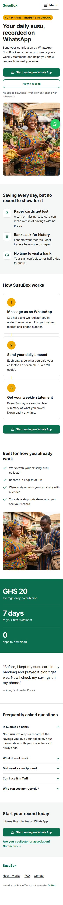
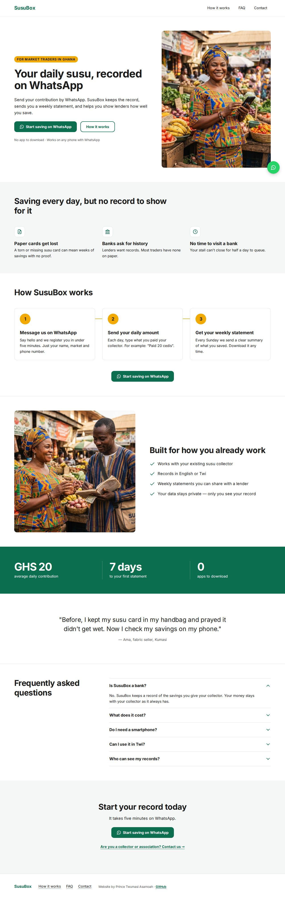

# SusuBox

Your daily susu, recorded on WhatsApp. A fast, mobile-first website for a digital susu savings service for market traders in Ghana.

Status: deployed on Netlify. The owner's details are still to come (see the [handover checklist](#handover-checklist)).

Live site: **[susubox-site.netlify.app](https://susubox-site.netlify.app/)** · Design prototype: [docs/design/](docs/design/)

| Mobile | Desktop |
| --- | --- |
| [](docs/screenshots/home-mobile.jpg) | [](docs/screenshots/home-desktop.jpg) |

More screenshots of the live site, taken on 5 November 2026, are in [docs/screenshots/](docs/screenshots/):
- [contact page, mobile](docs/screenshots/contact-mobile.jpg)
- [contact page, desktop](docs/screenshots/contact-desktop.jpg)
- [mobile menu](docs/screenshots/menu-mobile.jpg)

## PageSpeed Insights (mobile)

| Page | Performance | Accessibility | Best Practices | SEO |
| --- | --- | --- | --- | --- |
| Home | [score] | [score] | [score] | [score] |
| Contact | [score] | [score] | [score] | [score] |

Screenshots: [docs/pagespeed/](docs/pagespeed/)

Target: 90+ in every category on mobile. Before deploy, local Lighthouse (mobile) on the production build scored 100 / 100 / 100 / 100 on both pages, with LCP 1.6 s on Home. The table above is filled in from PageSpeed Insights on the live URL.

> **Note:** Netlify adds a "Powered by Netlify" badge script (`/.netlify/scripts/hud`) to the live site. It isn't part of this build, and it costs main-thread time on mobile. Turn it off under **Project configuration → General → Powered by Netlify badge** before running PageSpeed (see [Deploying to Netlify](#deploying-to-netlify)).

## Features

- Two pages: home and contact, plus a thank-you page after the form.
- Mobile-first layout, tested from 320px to 1280px.
- Sticky header on every screen size.
- Full-screen mobile menu built on the native `<dialog>` element, with a no-JavaScript fallback.
- Smooth scrolling to page sections, instant when the user prefers reduced motion.
- Floating WhatsApp button with a pre-filled message.
- Netlify Forms contact form with spam protection, inline validation, and sending, success and failure states.
- FAQ accordion that works without JavaScript.
- Accessible: WCAG 2.2 AA target, skip link, visible focus, labelled fields.

## Tech stack

- **Astro 7** (static output). It ships plain HTML, has built-in responsive image processing, and keeps copy in simple component files.
- **Hand-written CSS** with custom properties. No CSS framework.
- **Netlify Forms** for the contact form; **Netlify** for hosting.
- **Client JavaScript** is about 4 KB in total:
  - the mobile menu script, on every page;
  - the form enhancement, on the contact page only.

## Getting started

Prerequisites: Node.js 22.23.4 or later (`.nvmrc` pins Node 24).

```bash
npm install
npm run dev       # local dev server
npm run build     # static build into dist/
npm run preview   # serve the build locally
```

## Editing content

| What | Where |
| --- | --- |
| Business name, site URL, WhatsApp number and message, email, office hours | `src/config.ts` → `site` |
| Numbers strip figures | `src/config.ts` → `stats` |
| Testimonial (set to `null` to remove the section) | `src/config.ts` → `testimonial` |
| FAQ pricing answer | `src/config.ts` → `pricingAnswer` |
| Home page copy | `src/pages/index.astro` |
| Contact page copy, form labels and error messages | `src/pages/contact/index.astro` |
| Thank-you page | `src/pages/contact/thanks.astro` |
| Header / menu / footer links | `src/lib/nav.ts` |
| Colours, spacing and type | the tokens at the top of `src/styles/global.css` |

If the site moves to a custom domain, update `site.url` in `src/config.ts`, `site` in `astro.config.mjs` and the sitemap line in `public/robots.txt`.

## Adding the photos

The site uses two photos in `src/assets/`. If a file is missing, its slot shows a plain green placeholder block.

| File | Used for | Crop | Source size |
| --- | --- | --- | --- |
| `src/assets/hero-trader.jpg` | Home hero | 4:5 portrait | at least 1200 × 1500 |
| `src/assets/benefits-collector.jpg` | Benefits section | 1:1 square | at least 1200 × 1200 |

To replace a photo, drop in a new file with the same name and rebuild. Astro crops it and exports AVIF and WebP at 480, 800 and 1200px wide, plus an 800px JPEG fallback. Widths larger than the source are skipped; nothing is upscaled.

Both photos are cropped from the centre. To change the focus, edit `position` on the `<Photo>` in `src/pages/index.astro` (for the hero, the `hero` object at the top). It takes a keyword such as `"top"` or `"left"`, or `"attention"` for smart cropping. Per SHARED-STANDARDS §11, final photos should come from Unsplash or Pexels; add the credit below.

The current photos are 1408 × 768, so the hero is served at up to 614px wide and the benefits image at up to 768px. Sharper results need larger sources (see the table).

## Changing the WhatsApp number and form

- **WhatsApp number:** set `whatsappNumber` in `src/config.ts` in international format with no `+`, for example `233241234567`.
  - Every WhatsApp button on the site uses this one value.
  - Once it is no longer the placeholder, the number is also added to the page's structured data.
- **Form:** submissions appear in the Netlify dashboard under **Forms → contact**. Set email notifications there.
  - The form is plain HTML in `src/pages/contact/index.astro`, so Netlify detects it at deploy time.

## Deploying to Netlify

1. In Netlify, choose **Add new site → Import an existing project** and pick this GitHub repo.
2. The build settings come from `netlify.toml`: `npm run build`, publish directory `dist`, Node 24.
3. Deploy, then rename the site to `susubox-site` (**Site configuration → Change site name**).
4. Turn off the **Powered by Netlify badge** (**Project configuration → General**). Otherwise Netlify adds a ~35 KB script to every page, and the badge sits over the floating WhatsApp button. Some free plans may not offer the toggle.
5. Under **Forms**, make sure form detection is enabled, then redeploy. Submit a test message on `/contact/` and confirm it appears under **Forms → contact**.
6. Run PageSpeed Insights (mobile) on `/` and `/contact/`. Save screenshots in `docs/pagespeed/` and fill in the scores table above.

## Performance techniques

- **Images:**
  - Responsive AVIF/WebP with an 800px JPEG fallback, fixed `width`/`height` and a reserved aspect ratio, so there's no layout shift.
  - The hero image is preloaded with `fetchpriority="high"` and is the only preloaded image. Other images lazy-load.
- **Font:** one self-hosted font (Inter, Latin subset), two weights, `font-display: swap`. Only the regular weight is preloaded.
- **CSS:**
  - Each page's own CSS is inlined; it's always under 14 KB.
  - The shared stylesheet (~9 KB) is linked with a hashed file name and cached for a year.
- **JavaScript:** none on load apart from the ~1 KB menu script and, on the contact page, ~3 KB of form enhancement. No libraries.
- **No third-party requests** on page load: no analytics, maps or external fonts.
- **CSS-only** sticky header and smooth scroll. Animations use only `opacity`/`transform` and respect reduced motion.
- **Inline SVG icons.** No icon font.

## Handover checklist

Sample content to confirm or replace with the owner before launch. Each item is marked `SAMPLE:` or `TODO:` in the code.

**Business details** (`src/config.ts`)
- [ ] Business name: "SusuBox"
- [ ] WhatsApp number: currently the placeholder `233000000000`
- [ ] Email: `hello@susubox.example`
- [ ] Office hours: "Mon–Sat, 7am–6pm"
- [ ] Custom domain: live now at `https://susubox-site.netlify.app`; if it changes, also update `astro.config.mjs` and `public/robots.txt`
- [ ] Numbers strip: "GHS 20 average daily contribution", "7 days to your first statement", "0 apps to download"
- [ ] Testimonial from "Ama, fabric seller, Kumasi": replace with a real quote (with permission) or set `testimonial` to `null`
- [ ] Pricing: "Registration is free. A small monthly fee applies after your first month."

**Facts in the page copy**
- [ ] "we register you in under five minutes" (`src/pages/index.astro`, How it works)
- [ ] "Every Sunday we send a clear summary" (`src/pages/index.astro`, How it works)
- [ ] "we'll be in touch within one working day" (`src/pages/contact/thanks.astro`)
- [ ] Languages: "English or Twi" (Benefits, FAQ, structured data)

**Copy the spec doesn't define** (design placeholders in use)
- [ ] FAQ heading: "Frequently asked questions"
- [ ] Form error messages (`src/pages/contact/index.astro`)
- [ ] "Choose one" first option in the "I am a…" list
- [ ] Thank-you page title and description
- [ ] Footer disclaimer: none yet (for example, a line saying SusuBox is not a bank)

**Assets**
- [ ] Hero and benefits photos: the current ones are AI-generated placeholders from the design stage. Replace them with real photos (Unsplash/Pexels or the owner's own, with permission) and update the credits below.
- [ ] Open Graph image `public/og.jpg`. It shows the hero headline only, with no sample figures. Regenerate it from `scripts/brand/og.html` if the branding changes.
- [ ] Favicon `public/favicon.svg` and `public/apple-touch-icon.png` (rebuild with `node scripts/make-touch-icon.mjs`)

## Project documentation

- [docs/SPEC.md](docs/SPEC.md): build spec (source of truth)
- [docs/SHARED-STANDARDS.md](docs/SHARED-STANDARDS.md): standards shared by all three demo sites
- [docs/design/](docs/design/): mockups, clickable prototype and developer handoff

## Credits

Website by [Prince Twumasi Asamoah](https://github.com/prince-t-asamoah) ([LinkedIn](https://linkedin.com/in/prince-t-asamoah)).

Photo credits: `src/assets/hero-trader.jpg` and `src/assets/benefits-collector.jpg` are AI-generated images (Google generative AI; C2PA/SynthID metadata in the originals) supplied for the design mockups. They are not photos of real people or SusuBox customers.

Font: [Inter](https://rsms.me/inter/) by Rasmus Andersson, SIL Open Font License 1.1 (`public/fonts/OFL.txt`).

## Licence

MIT. See LICENSE.
